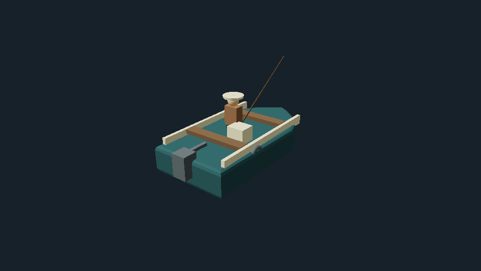
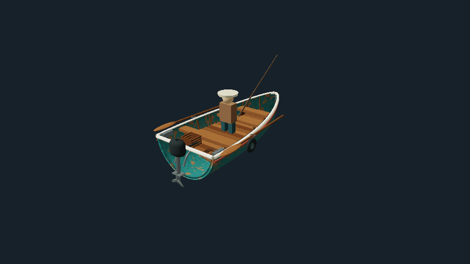
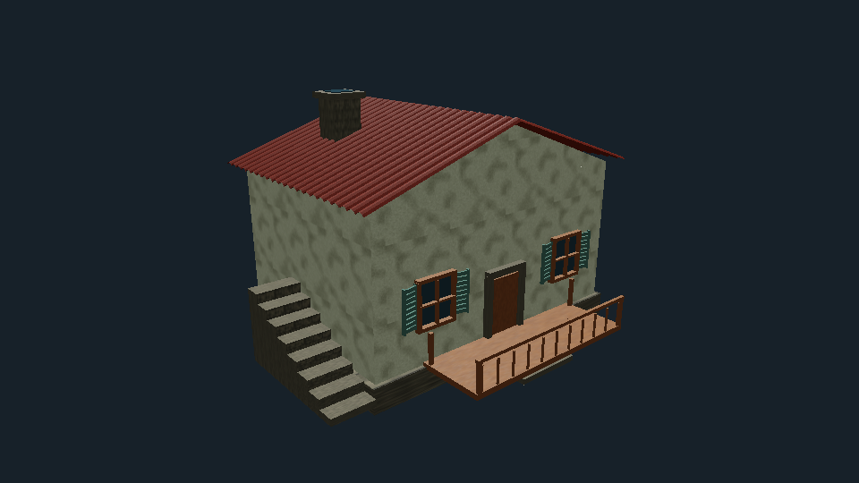

# O Pescador — modelos e costa V2

Implementado sobre a V1, sem outra página ou jogo. Three.js 0.180.0 direto, WebGLRenderer, módulos ES locais; Y vertical, XZ navegação, dimensões em unidades do mundo (tratadas como metros). O loop continua em main.js; world.js recebe estado, anima os modelos e conserva câmera e flutuação existentes.

## Alterações

- `dist/models/BoatModel.js`: casco BufferGeometry fechado, perfis transversais curvos, proa afilada, UVs e normais; interior com tábuas e três bancos, bordas claras, faixa vermelha, remos, corda, rede, caixa, ferragens e motor com hélice animada. Pontos de personagem, vara e equipamentos preservados. O casco continua subordinado à flutuação V1; nenhum segundo sistema de movimento foi criado.
- `ModelUtils.js`: materiais PBR compartilhados, mapas de cor sRGB e normal/roughness lineares; agrupamento de geometrias por material e descarte.
- `Terrain.js` / `RockyHeight.js`: relevo com altura compartilhada pela malha e distribuição vegetal, mantendo a região costeira original.
- `Vegetation.js`: tufos curvos instanciados, seed determinística, vento no shader, exclusão de água/encostas/casas/caminhos, flores e arbustos volumétricos; densidade reduzida por distância e qualidade sem reconstrução por frame.
- `Village.js`: três famílias reutilizáveis de casas, telhas curvas, empenas, reboco/pedra, portas, janelas, venezianas, chaminés, varandas e escadas. LOD e materiais compartilhados; telhado da casa familiar isolado para melhorias.
- `CoastModel.js`: píer de tábuas, pilares, cordas, barris instanciados, mercado, caixas, peixes, caminhos, cercas, árvores com LOD, rochas e dois barcos amarrados fora da área navegável.
- `AssetManager.js`: GLTFLoader oficial local r180; cache de carregamentos, escala/orientação/sombras, liberação por referências e fallback procedural. Draco/Meshopt podem ser injetados quando um asset exigir. Nenhum GLB fictício ou caminho pendente. O carregador é voltado a modelos estáticos; modelos com esqueleto são rejeitados explicitamente.
- `dist/world.js`: integração dos módulos, atualização do motor/vegetação/qualidade e limpeza de recursos.

Oceano, física de navegação, pesca, colisões simplificadas, missões, interface e câmera mantêm suas implementações. `dist/ocean`, `main.js`, `systems.js`, `config.js`, `index.html`, `style.css` e `fallback.js` não foram alterados nesta etapa.

## Validação executada

- `npm test`: **26 testes, 26 aprovados** (8 de regras, 9 do oceano, 9 de modelos). Inclui captura completa controlada, rompimento da linha, compras/save, flutuação, malha fechada/UVs/normais, pontos vegetais válidos, LOD, cache e parsing de GLB real em memória.
- `npm run build`: validação sintática e presença de recursos aprovada. Projeto estático, sem bundler.
- `git diff --check`: sem problemas de whitespace.
- `python3 scripts/render-models.py`: geometrias reais exportadas do construtor original e novo, renderizadas com profundidade em Mesa EGL/llvmpipe OpenGL ES 3.2. Inspeção de casco, bancos, motor e casa realizada. Usa shader GGX de diagnóstico; **não equivale ao renderer Three.js nem a captura do jogo completo**.
- Navegador abriu HUD no fallback existente, mas informou `GL_RENDERER = Disabled` e erro de criação de contexto. Não foi possível verificar toda a cena WebGL, vento no material final, navegação visual, colisões visuais, câmera/redimensionamento 3D ou ausência de erros de shader no navegador. Não há resultados de FPS ou tempo GPU.

## Evidências visuais

Mesmo enquadramento e shader de diagnóstico para o barco antigo e novo:





## Reprodução

```sh
npm test
npm run build
python3 -m http.server 8080 --directory dist
# Opcional: regenerar os cinco materiais autorais (Pillow e NumPy)
python3 scripts/make-materials.py
# Para regenerar também os mapas rochosos e a altura, passar o ZIP de origem:
python3 scripts/make-materials.py /caminho/o_pescador_rocky_terrain_threejs.zip
# Diagnóstico offscreen: requer Pillow, NumPy e bibliotecas EGL/GLES do Mesa
python3 scripts/render-models.py
```

Os mapas finais estão incluídos; o ZIP não é necessário para executar o jogo. Créditos em `ASSET_CREDITS.md`.

## Limitações restantes

- Validar a cena completa em GPU WebGL 2, desktop e celular, incluindo viagem, captura/venda, melhoria da casa, redimensionamento, reflexo do novo cenário e custo de draw calls/sombras. Ajustar densidade/LOD com medições reais.
- Modelos são procedurais mais detalhados, não fotogrametria. Personagem e peixes conservam geometria simples. Casas não têm interiores. Materiais autorais requerem direção artística adicional para alcançar a referência semi-realista.
- Vegetação usa vento visual leve; normais não são deformadas analiticamente. Transições de contagem/LOD podem ser perceptíveis. Flores e arbustos têm culling do conjunto, sem LOD individual.
- Barcos decorativos são estáticos; só o barco do jogador usa flutuação. Decoração foi colocada no setor costeiro já bloqueado, sem adicionar colisores individuais nem alterar controles.
- Texturas JPEG/PNG locais com resolução limitada; sem KTX2/Basis. Nenhum decoder é baixado sem um asset que o necessite.
- Carregador externo pronto para assets estáticos opcionais, mas a cena usa os modelos procedurais entregues. Não faltam GLBs necessários à execução.
