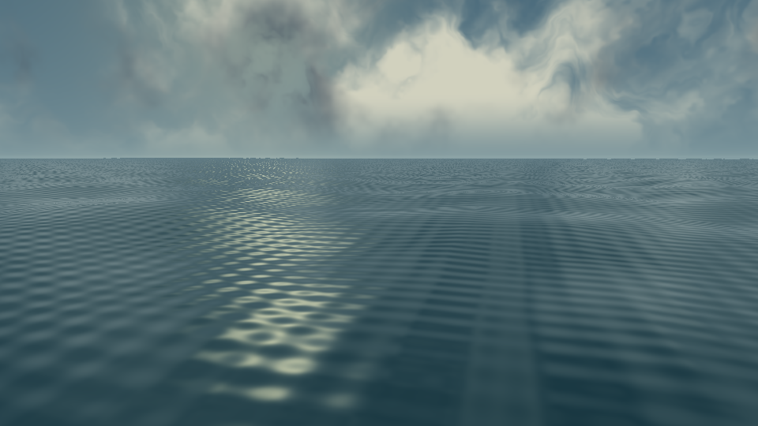
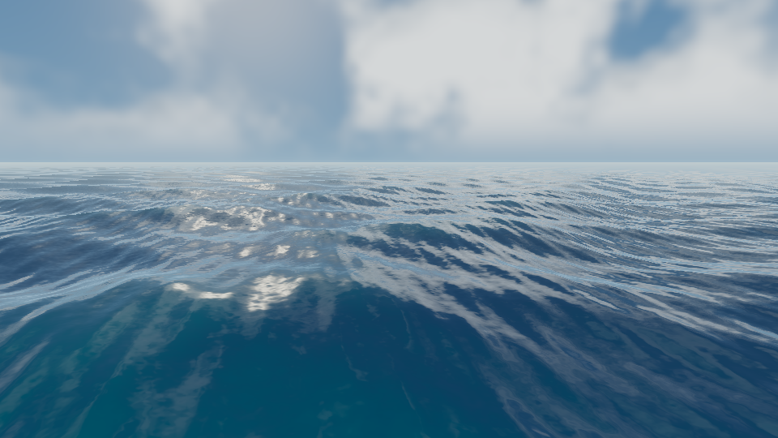

# Graphics Overhaul V1 — oceano

Implementado diretamente no mesmo projeto `appgprj_6ae33414156c8191973588a244c75b86`, sem nova página ou jogo. Base inspecionada: commit `4f990c3fd185f8d18a6d3619c3a074750725b68e`.

## Auditoria antes das alterações

- Three.js **r180 / 0.180.0**, módulos ES locais em `dist/vendor`. Uso direto, sem React/R3F.
- `WebGLRenderer`, WebGL 2, antialiasing, ACES Filmic, exposição 1.15. Sem EffectComposer/passes de pós-processamento.
- `world.js`: oceano anterior em PlaneGeometry 2200 × 2200, 240 segmentos por eixo, três senos, normais aproximadas; reflexo do céu simulado e espuma radial.
- `main.js`: `requestAnimationFrame`, delta máximo 0.05 s; aceleração, inércia, ré, guinada, combustível e colisão costeira.
- Flutuação anterior: seno independente da água, sem amostragem da superfície.
- Sol direcional, HemisphereLight, PCF soft shadows e neblina exponencial. Céu procedural sem conversão explícita final de cores.
- Coordenadas: **Y para cima**, plano XZ, proa local em **−Z**, yaw ao redor de Y. Unidade tratada como metro; tempo em segundos, velocidade em m/s e HUD em nós.
- Referência consultada: `image(2).png`, com ondulação 3D, azuis profundos, transparência aparente turquesa nas cristas e brilho solar fragmentado.

## Arquivos

| Arquivo | Alteração |
|---|---|
| `dist/ocean/OceanPhysics.js` | Novo: parâmetros compartilhados de seis Gerstner, inversão de XZ, normais/velocidade analíticas e flutuação em cinco pontos |
| `dist/ocean/OceanRenderer.js` | Novo: malha com densidade adaptativa, uniforms, reflexão planar, histórico de esteira, presets e dispose |
| `dist/ocean/WaterShader.js` | Novo: deslocamento 3D, normais, Fresnel, solar anisotrópico, absorção, espuma, esteira e fog |
| `dist/ocean/AtmosphereShader.js` | Novo: ambiente compartilhado entre céu e água, pipeline linear/ACES/sRGB |
| `dist/world.js` | Integração dos módulos, flutuação do barco/boia/peixes/tubarão, linha ancorada no barco e reflexos |
| `dist/main.js` | Apenas sinal de potência do motor e descarte ao sair; navegação/colisões/regras mantidas |
| `scripts/build.mjs` | Validação sintática recursiva dos novos módulos |
| `tests/ocean.test.mjs` | Nove testes do sistema oceânico |
| `scripts/check-shaders.py`, `scripts/shader-sources.mjs` | Compilação/link GLSL em EGL, comparação CPU/shader e capturas de diagnóstico |
| `tests/fixtures/ocean-v0.json` | Shaders originais, preservados somente como fixture do comparativo |
| `docs/ocean-before.png`, `docs/ocean-after.png` | Capturas reais do teste offscreen dos shaders |
| `README.md`, `dist/o-pescador-source.zip` | Documentação e pacote de fontes atualizados |

`index.html`, `style.css`, `systems.js`, `config.js` e `fallback.js` permanecem idênticos à base. Inventário, economia, missões, save e regras de pesca/combate não foram substituídos.

## Superfície e flutuação

Cada onda usa direção normalizada, comprimento, amplitude, steepness, fase e frequência angular. Os mesmos arrays Float32 são usados pela CPU e enviados como uniforms ao shader. O deslocamento inclui X/Z, não apenas altura.

`sampleOceanSurface(worldX, worldZ, time, out?)` retorna altura, normal, velocidade orbital e direção normalizada. A inversão de Newton encontra a coordenada paramétrica correspondente ao XZ real deslocado. Passar `out` reutiliza memória. `OceanPhysics.configure` permite configurar vento, direção e intensidade base; o clima multiplica a intensidade sem alterar bruscamente a fase.

A flutuação amostra centro, proa, popa, bombordo e boreste. Suaviza heave/pitch/roll e mantém uma margem de convés nos cinco pontos. Não altera XZ, velocidade, colisões ou yaw. O yaw usa Euler YXZ para preservar a orientação durante a inclinação. A câmera continua seguindo suavemente e aceita o arrasto; foi recuada e seu alvo adiantado para mostrar mais horizonte. A altura recebe apenas 35% do movimento vertical do barco.

A boia acompanha a mesma superfície, a linha parte de uma âncora transformada com o barco, e peixes/barbatana recebem a altura local. As regras de captura não mudam.

## Água, reflexão e atmosfera

- Seis ondas em direções/comprimentos não múltiplos simples; normais analíticas no fragment shader e detalhes de ruído multiescala, sem textura estática disfarçada de mar.
- Fresnel Schlick, brilho solar anisotrópico, absorção Beer–Lambert, água rasa verde-turquesa e profundidade azul, espuma de compressão nas cristas e espuma costeira.
- Profundidade é uma **batimetria analítica aproximada** da ilha elíptica existente. Não é depth texture nem reconstrução real do terreno. O material permanece opaco e escreve profundidade: sem ordenação de transparências.
- Reflexão planar real da cena em câmera espelhada sobre Y=0, render target, clipping oblíquo, distorção por normal e transição suave para o céu procedural fora da imagem refletida.
- Pass de reflexão sem tone mapping, com textura linear; ACES e conversão de saída são aplicados apenas na saída principal. Half-float quando suportado, RGBA8 linear como fallback.
- Sol, céu, água e fog usam direção e iluminação compartilhadas. O sol foi baixado de Y=100 para Y=55 para aproximar o reflexo da referência.
- Espuma do casco, anéis de deslocamento e trilha persistente em world space. O motor ligado adiciona turbulência, enquanto o barco em inércia continua gerando deslocamento. Buffer circular fixo; sem instanciar partículas por frame.

## Geometria, qualidade e recursos

Uma malha conectada em anéis de densidade variável, com raio de 1900 m, segue continuamente o jogador. As fases são calculadas em coordenadas mundiais: recentralizar não reinicia as ondas. A topologia tem apenas uma borda externa; não há sobreposição de tiles. Ondas curtas perdem amplitude suavemente antes da região distante de baixa densidade. A física local usa todas as ondas, integralmente, na área próxima do barco.

| Preset | Vértices | Triângulos | Reflexo | Frequência máxima | Camadas de detalhe | Eventos de esteira |
|---|---:|---:|---:|---:|---:|---:|
| Baixa | 7.297 | 14.496 | 256² | 10 Hz | 2 | 12 |
| Média | 28.417 | 56.640 | 512² | 20 Hz | 3 | 24 |
| Alta | 51.201 | 102.144 | 1024² | 30 Hz | 4 | 32 |

Geometria/material/target não são recriados por frame. Troca de preset descarta a geometria e o target antigos. Resize invalida o reflexo, que recebe a nova projeção sem realocar desnecessariamente. `dispose()` libera recursos e remove o listener de resize. O pass restaura render target, viewport, scissor, cor de limpeza, XR, tone mapping e atualização de sombras mesmo se houver exceção.

`OceanRenderer.stats` registra chamadas/triângulos dos passes e tempo CPU de submissão da reflexão. Isso **não** é tempo GPU nem uma medição validada de FPS.

## Verificação executada

1. `npm run build`: passou; arquivos presentes e sintaxe dos módulos validada.
2. `npm test`: **17 aprovados, 0 falhas**. Oito testes originais de gameplay + nove de ondas, normais, velocidade, configuração, flutuação, topologia LOD, pipeline de shader, descarte e clipping/restauração do pass de reflexão.
3. `python3 scripts/check-shaders.py`: shaders de água Baixa/Média/Alta e céu compilaram e vincularam em **OpenGL ES 3.2, Mesa llvmpipe (renderização por software)**.
4. Transform feedback executou o vertex shader de produção em 12 pontos. Diferença máxima CPU/shader: **0.00000226 metros**. Isso valida deslocamento e parâmetros compartilhados, não desempenho de uma GPU física.
5. `python3 scripts/check-shaders.py --render`: capturas antes/depois em 960×540 dos shaders e malhas reais, com câmera, horário e exposição controlados. Permitiu corrigir brilho excessivo e padrões repetitivos das normais. **São diagnósticos offscreen do oceano e céu; não são screenshots da partida.** Barco, interface, terreno e pass de reflexão planar não fazem parte dessas capturas; usa-se o fallback de reflexão atmosférica.
6. No navegador remoto, recarregamento, HUD original e configurações continuaram acessíveis. O contexto WebGL segue desativado (`GL_RENDERER = Disabled`), como antes da alteração, e o modo 2D original é acionado. Console sem novo erro de import/sintaxe observado; o erro preexistente de criação de WebGL permanece. **Não é possível afirmar que o console da cena 3D está sem erros.**
7. `git diff` confirmou ausência de mudanças em HTML/CSS, configurações econômicas, regras de jogo e fallback.

### Comparativo de diagnóstico

Antes: `ocean-before.png`. Depois: `ocean-after.png`.

## Limitações e aceitação pendente

A implementação e a melhora visual dos shaders foram verificadas offscreen. **A aceitação da cena completa ainda depende de WebGL ativo.** Não se declara concluída a validação de navegação/pesca/câmera/reflexos em uma GPU real.

- Reflexo planar usa nível médio da água; não representa reflexão exata de cada crista nem oclusão de múltiplas ondas. Pode requerer ajuste de clipping/distorção próximo ao casco após inspeção em WebGL.
- Batimetria não acompanha pedras individuais nem o fundo real. Sem refração por depth buffer, cáusticas, spray volumétrico ou simulação de fluido.
- A margem do convés é garantida nos pontos amostrados; não há colisão contínua entre cada triângulo do casco e cada onda. Flutuação é visual, não hidrodinâmica rígida.
- Espuma é procedural, sem advecção física. Microdetalhe visual não produz força adicional no barco.
- Continuidade LOD foi verificada por topologia e world space, mas aliasing/silhueta em movimento ainda precisam de inspeção no navegador 3D.
- Resize e presets foram verificados estruturalmente/testes; sua apresentação final em WebGL e mobile não foi confirmada.
- Não há comparação de FPS nem tempo GPU confiável. llvmpipe não representa desempenho em hardware.
- Modelos simples de barco/costa e nuvens procedurais continuam abaixo da referência artística; não foram substituídos nesta etapa de oceano.

Próxima validação: em navegador com WebGL 2, testar todos os presets e resize, navegar/virar/parar/dar ré, observar casco e esteira, capturar/vender um peixe e acompanhar um tubarão; registrar frames da cena e medir frame time antes de calibrar efeitos adicionais.
